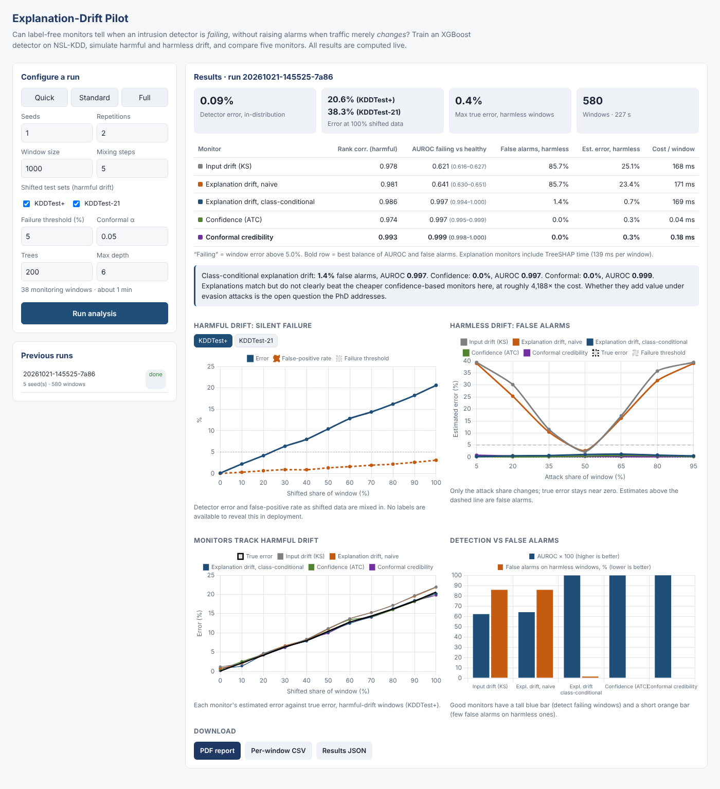

# Explanation-Drift Pilot

Can label-free monitors tell when a machine-learning intrusion detector is **failing**, without raising alarms when traffic merely **changes**?

This application trains an XGBoost intrusion detector on NSL-KDD, simulates harmful drift (the detector fails) and harmless drift (traffic changes but the detector stays accurate), and compares five monitors that never see labels. You configure and run the analysis in a browser, watch progress live, explore the results in interactive charts and download a PDF report.

It is the pilot study for the PhD proposal *"Is the Detector Still Right? Explanation-Based Monitoring of AI Intrusion Detection under Drift and Attack"* (O.A. Agunloye).



## Quick start

Requires [Docker](https://docs.docker.com/get-docker/) with Docker Compose.

```bash
docker compose up --build
```

Then open **http://localhost:8000**.

1. Pick a preset (**Quick** ≈ 1 min, **Standard** ≈ 2–3 min, **Full** ≈ 4 min) or set the parameters yourself.
2. Press **Run analysis** and watch the progress bar.
3. Explore the results, switch between test sets on the harmful-drift charts, and download the **PDF report**, the **per-window CSV** or the **results JSON**.

Past runs are kept in a Docker volume (`pilot-runs`) and listed under *Previous runs*. Stop with `Ctrl+C` or `docker compose down`; add `-v` to delete stored runs.

Without Compose:

```bash
docker build -t explanation-drift-pilot:1.0 .
docker run -p 8000:8000 -v pilot-runs:/app/runs explanation-drift-pilot:1.0
```

## What the pilot does

| Step | Detail |
|---|---|
| Detector | XGBoost (default 200 trees, depth 6) trained on 80% of KDDTrain+ |
| Reference | 5,000 held-out validation records |
| Harmful drift | Windows that mix validation records with 0–100% records from KDDTest+ or KDDTest-21 |
| Harmless drift | Validation records only, with the attack share changed (5–95%); true error stays near zero, so any alarm is false |
| Failing window | True window error above the failure threshold (default 5%) |
| Error estimate | Each monitor is mapped to estimated error with an isotonic fit on that seed's harmful-drift windows |

### Monitors

| Monitor | What it measures |
|---|---|
| Input drift (KS) | Mean per-feature two-sample Kolmogorov–Smirnov statistic, window vs reference |
| Explanation drift, naive | Mean per-feature Wasserstein distance between window and reference TreeSHAP values |
| Explanation drift, class-conditional | The same, computed within each predicted class and weighted by class share |
| Confidence (ATC) | Share of predictions below the confidence threshold that matches validation error (Garg et al., 2022) |
| Conformal credibility | Share of predictions whose inductive conformal credibility is below α, with class-conditional calibration |

### Outputs

- **Rank correlation** of each monitor with true error on harmful drift
- **AUROC** separating failing from healthy windows, with 95% confidence intervals across seeds
- **False-alarm rate** on harmless windows
- **Cost per window** in milliseconds (explanation monitors include SHAP computation)

## Example results

`examples/` contains the output of a Full run (5 seeds, 580 windows):

| Monitor | AUROC (95% CI) | False alarms, harmless | Cost per window |
|---|---|---|---|
| Input drift (KS) | 0.621 (0.616–0.627) | 85.7% | 168 ms |
| Explanation drift, naive | 0.641 (0.630–0.651) | 85.7% | 171 ms |
| Explanation drift, class-conditional | 0.997 (0.994–1.000) | 1.4% | 169 ms |
| Confidence (ATC) | 0.997 (0.995–0.999) | 0.0% | 0.04 ms |
| Conformal credibility | 0.999 (0.998–1.000) | 0.0% | 0.18 ms |

Naive explanation drift is as confounded as raw input drift. Comparing explanations within each predicted class removes most of that confound, but on this benchmark it only matches the far cheaper confidence-based monitors. Whether explanations add value, for example under evasion attacks that produce confident mistakes, is the open question the PhD addresses.

Files: `full-run-report.pdf`, `full-run-results.json`, `full-run-windows.csv`.

## Limitations

- NSL-KDD has no timestamps, so mixture shift stands in for temporal drift. It is an ageing dataset that pre-dates widespread encryption.
- Harmless drift is constructed (attack-share change). The full study defines it by outcome on naturally occurring shifts.
- One model family; no adversarial evasion.
- Results are a feasibility check, not evidence about deployed systems.

## Project layout

```
app/
  engine.py        analysis: data loading, detector, monitors, scenarios, summary statistics
  report.py        PDF report (matplotlib figures, ReportLab layout)
  server.py        FastAPI: background runs, progress, results and downloads
  static/          browser interface (HTML, JavaScript, Chart.js)
data/              NSL-KDD: KDDTrain+.txt, KDDTest+.txt, KDDTest-21.txt
examples/          output of a Full run
Dockerfile, docker-compose.yml, requirements.txt
```

## API

| Method | Path | Purpose |
|---|---|---|
| GET | `/api/defaults` | Default configuration |
| POST | `/api/estimate` | Window count and approximate run time for a configuration |
| POST | `/api/runs` | Start a run (JSON body with any configuration fields) |
| GET | `/api/runs` | List runs |
| GET | `/api/runs/{id}` | Status, progress and, when finished, results |
| GET | `/api/runs/{id}/report.pdf` | PDF report |
| GET | `/api/runs/{id}/windows.csv` | Per-window results |
| GET | `/api/runs/{id}/results.json` | Summary results |

Runs are processed one at a time because they are CPU-intensive; further runs queue.

## Running without Docker

Python 3.12 is recommended.

```bash
pip install -r requirements.txt
uvicorn app.server:app --port 8000
```

## Data

NSL-KDD: Tavallaee, M., Bagheri, E., Lu, W. and Ghorbani, A.A. (2009) 'A detailed analysis of the KDD CUP 99 data set', *IEEE Symposium on Computational Intelligence for Security and Defense Applications*. Dataset © Canadian Institute for Cybersecurity, University of New Brunswick; see https://www.unb.ca/cic/datasets/nsl.html for terms of use.

## Author

Olanrewaju (Lanre) Adams Agunloye · lanreadams88@gmail.com · linkedin.com/in/digitallanre
